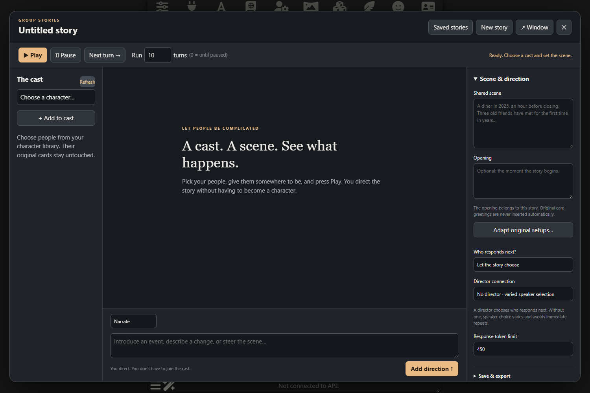

# Group Stories

**A cast. A scene. See what happens.**

A separate SillyTavern workspace for grounded, contemporary ensemble stories. Choose the people, give them a starting situation, and watch their relationships develop—without having to join as a user character.

You can step in as narrator, privately influence one character, or write a character's next contribution yourself. Let the story run for a few turns, pause to change direction, then pick it up again.

[Install](#install) · [Start a story](#start-a-story) · [Privacy and limits](#privacy-model-and-limits) · [Verification](docs/verification.md)



*The workspace running in local SillyTavern 1.19. Cast and story areas start empty so you can bring your own people and premise.*

## What you can do

| Control | What it gives you |
| --- | --- |
| **Cast & connections** | Import people from your character library and choose a different connection profile for each. |
| **Play / Pause / Next turn** | Watch a bounded run, continue until paused, or advance one contribution at a time. |
| **Narrate** | Introduce a shared event or steer the scene without becoming a character. |
| **Privately influence** | Give one character motivation or knowledge that stays out of other characters' prompts. |
| **Speak as character** | Write someone's dialogue or action yourself. |
| **Director** | Optionally let a separate model choose who responds next, or make the choice yourself. |
| **Presence** | Send a character away and bring them back without giving them knowledge of missed events. |
| **Separate window** | Open another synchronized view, with one generation loop shared across both. |
| **Saved stories & exports** | Resume stories in this browser, export a complete backup, or save a public text transcript. |

## Install

Requires **SillyTavern 1.19 or later**, a browser supporting Web Locks, IndexedDB and BroadcastChannel, and at least one supported Chat Completion or Text Completion profile in SillyTavern's **Connection Manager**. Chromium was tested; other supporting browsers have not yet been verified.

1. Open **Extensions → Install extension** in SillyTavern.
2. Paste this repository URL:

   ```text
   https://github.com/rustyorb/SillyTavern-GroupStories
   ```

3. Install, then reload SillyTavern.
4. Open **Group Stories** from the extensions/wand menu.

**No build step. No package installation.** The repository contains the ready-to-run JavaScript and CSS.

For local development, copy `manifest.json`, `index.js`, `core.js`, `engine.js`, `storage.js` and `style.css` into `data/<your-user>/extensions/group-stories/`, then reload. Only the dedicated local instance at `http://127.0.0.1:8123/` was used during development.

## Start a story

1. Select a character from your existing SillyTavern library and click **Add to cast**. Repeat for the rest of the cast.
2. Select a connection profile under each character. Connections are used independently without switching your main SillyTavern connection.
3. Write the shared scene and optional opening. Original character greetings are not inserted. **Adapt original setups…** can draft a coherent shared premise for you to review and edit before using it; this makes a model request with the chosen director or first configured character profile.
4. Press **Next turn** for one contribution or **Play** for the selected number of turns. Choose `0` to continue until paused.
5. Use **Narrate** for shared events, **Privately influence** for one character's motivation or knowledge, or **Speak as character** to write a contribution yourself. The mode and recipient are remembered per story.

Choose **Who responds next?** for a one-turn speaker override. An optional director profile chooses speakers based on public story events. Without a director, selection varies while avoiding immediate repeats. The character can respond with dialogue, action or silence expressed in prose.

**Leave scene** stops a character receiving future public events. Returning does not grant knowledge of missed events. You can explicitly tell them what happened through a private direction or another character's public dialogue. The shared scene and opening are foundational information available to every cast member; keep secrets in private directions.

**Pause** aborts the active request and discards late responses even when a provider ignores cancellation. A direction, presence change or scene edit during generation invalidates that turn; start again to use the new state. Closing the workspace panel leaves a running story active. Closing/reloading its browser tab stops that tab's run.

## Saved stories and additional views

Stories save automatically to IndexedDB in the current browser, separated by SillyTavern account. **New story** archives the previous story. **Saved stories** switches between them. **Window** opens the same SillyTavern origin in a separate window, with the same active story and synchronized controls. Web Locks enforce one generation loop per origin across views; Pause works from either view.

This is browser-local storage, not server synchronization. A different browser, computer or origin does not share it. Export backups before clearing browser data. JSON story backups include identities, original setups, complete history, private directions and audience lists. Public text exports omit private directions, but include any secrets characters subsequently disclosed through public dialogue.

## Privacy model and limits

Each public event stores its witnesses when it occurs. A character request includes only its own card, the shared scene/opening and events that include that character in their audience. Private directions have exactly one recipient. The director receives public events and cast names, never private directions or character cards. There are no omniscient summaries or recall systems that can bypass this filtering.

Private means isolated in model prompts, not encrypted or hidden from the human directing the story. Private directions remain visible in this workspace and its saved backup. All selected providers still receive the prompts sent to them. Model behavior may infer facts from public clues; prompt filtering cannot guarantee a model will never guess or invent a secret.

The first version supports one active story across the browser's views, up to 40 characters and 10,000 imported events. Prompts stop with an explanation beyond approximately 90,000 characters rather than silently trimming canon. Provider token context limits may be lower. A director returning an invalid id stops visibly instead of inventing a result. Original cards, native chats and global connection selection are not modified.

Private character-to-character conversations, automatic summaries/recall, World Info integration, native chat import, Studio handoffs and automated auditions are not implemented in this version. Private influence is a directing instruction; character responses appear in the shared scene.

## Development and validation

Run `npm test` with Node.js 22 or later. No packages are required. Tests cover per-recipient privacy, absence, card/setup separation, turn limits, director errors, interruption, stale responses and shared run ownership.

For the optional local UI check, make Playwright available to Node and run `node tests/live-ui.cjs`. Alternatively set `GROUP_STORIES_PLAYWRIGHT` to an existing Playwright package directory. The check targets only `http://127.0.0.1:8123/`, uses an isolated browser, injects temporary in-memory test characters and simulated provider responses, and writes evidence under `work/live-ui/`. `GROUP_STORIES_UI_OUTPUT` can select another evidence directory. It does not save test characters or connection profiles to the host.

UI verification uses the local SillyTavern with simulated character responses. No real credential-backed model generation was used during this version's verification. See `docs/verification.md` for the checked behaviors.

## Feedback

Found a problem or have an idea? [Open an issue](https://github.com/rustyorb/SillyTavern-GroupStories/issues). For a bug, include your SillyTavern version, browser, steps to reproduce, and the visible status message. Remove private directions, story content and credentials from anything you share.

## License

[MIT](LICENSE).
